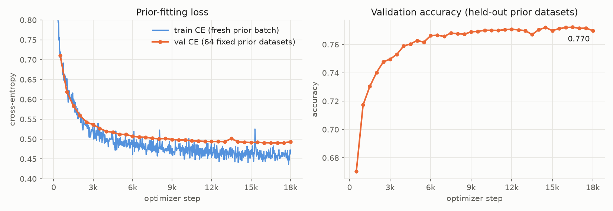
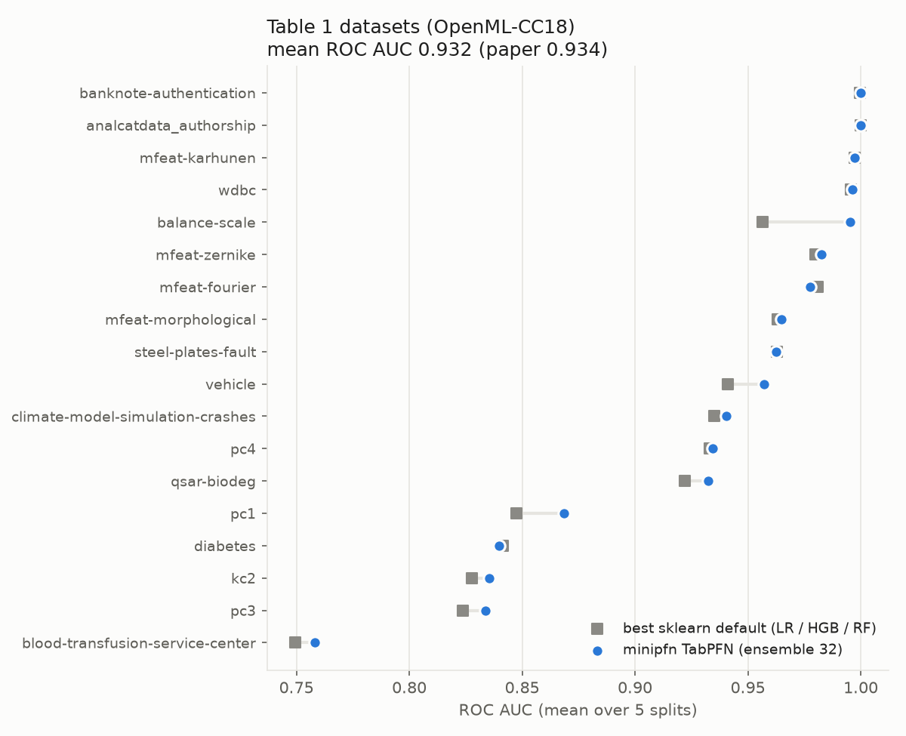

# minipfn TabPFN (v1 reproduction)

A from-scratch reproduction of TabPFN (Hollmann et al., [arXiv:2207.01848](https://arxiv.org/abs/2207.01848), ICLR 2023), trained with the paper's prior and budget. Code: [Aiden-Jeon/minipfn](https://github.com/Aiden-Jeon/minipfn) (`src/minipfn/tabpfn/`).

This is not the official TabPFN checkpoint. For the official models see [PriorLabs/TabPFN](https://github.com/PriorLabs/TabPFN).

## Model

- Architecture: TabPFN v1 Transformer (12 layers, emsize 512, 4 heads, post-norm), 25.82M parameters
- Inputs: up to 100 numerical features, up to 10 classes, up to 1,000 training rows
- Prior: v1 prior bag (SCM and BNN with differentiable hyperparameters, GP) ported to PyTorch
- Training: 18,000 steps, batch 512 datasets, 8×H100 (about 2 hours)

## Training

Train CE is the loss on each step's freshly sampled prior batch; val CE and accuracy are on 64 fixed prior datasets, logged every 500 steps. Final val CE 0.493, val accuracy 0.770.



## Results (paper Table 1)

Mean ROC AUC over the 18 OpenML-CC18 datasets in Table 1 (5 splits each).

| Method | This model | Paper |
| --- | --- | --- |
| TabPFN (ensemble 32) | 0.932 | 0.934 |
| TabPFN (no ensemble) | 0.928 | 0.932 |
| LogisticRegression (sklearn default) | 0.918 | – |
| HistGradientBoosting (sklearn default) | 0.908 | – |
| RandomForest (sklearn default) | 0.906 | – |

Per dataset, against the best of the three sklearn defaults:



## Usage

```bash
uv pip install "minipfn @ git+https://github.com/Aiden-Jeon/minipfn"
```

```python
from minipfn.tabpfn.evaluate import tabpfn_predict_proba
from minipfn.tabpfn.hub import from_pretrained

model, config = from_pretrained("aiden-jeon/minipfn-tabpfn-v1")
proba = tabpfn_predict_proba(model, x_train, y_train, x_test)  # (n_test, n_classes)
```

Labels must be integers `0..C-1`. To reproduce Table 1:

```bash
uv run python scripts/eval_tabpfn.py --hub-repo aiden-jeon/minipfn-tabpfn-v1
```

## Files

- `model.safetensors`: weights
- `config.json`: `TabPFNConfig` used for training (model size, prior and optimizer settings)
- `NOTICE`: attribution notices required by Apache-2.0
- `images/`: figures used in this card

## License

Apache-2.0. The prior and evaluation code are derived from the official TabPFN v1 code ([automl/TabPFN](https://github.com/automl/TabPFN), branch `tabpfn_v1`, Apache-2.0, Copyright 2022 The University of Freiburg); see `NOTICE`.

## Citation

```bibtex
@inproceedings{hollmann2023tabpfn,
  title     = {TabPFN: A Transformer That Solves Small Tabular Classification Problems in a Second},
  author    = {Hollmann, Noah and M{\"u}ller, Samuel and Eggensperger, Katharina and Hutter, Frank},
  booktitle = {International Conference on Learning Representations},
  year      = {2023}
}
```
