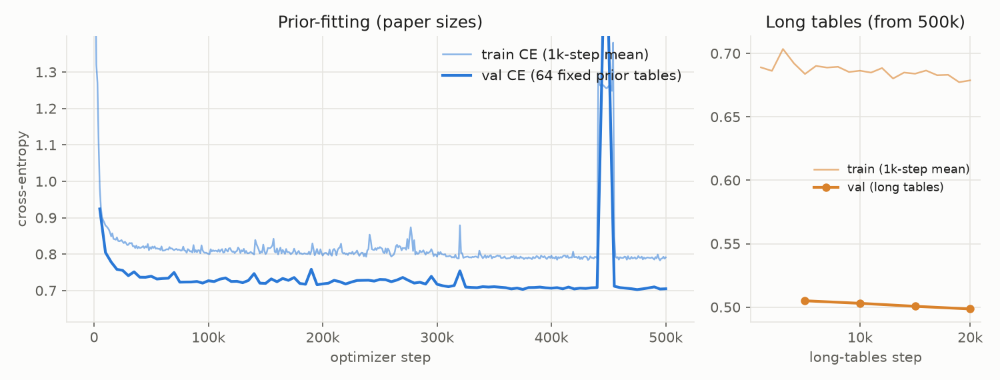
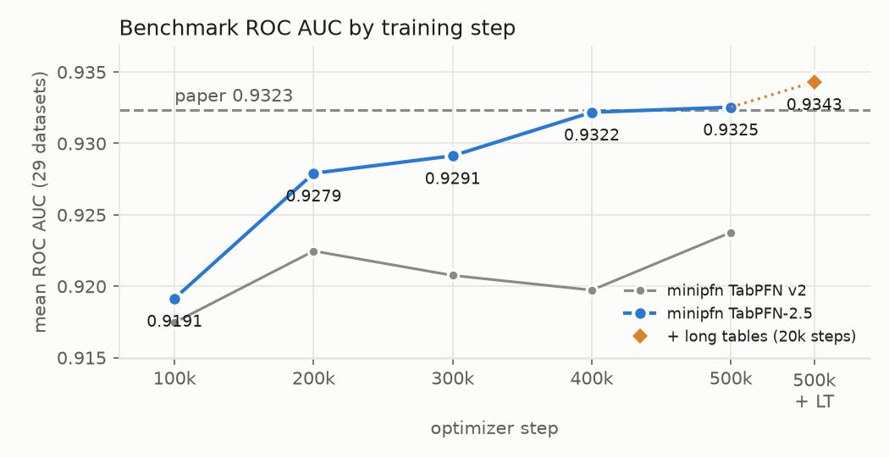
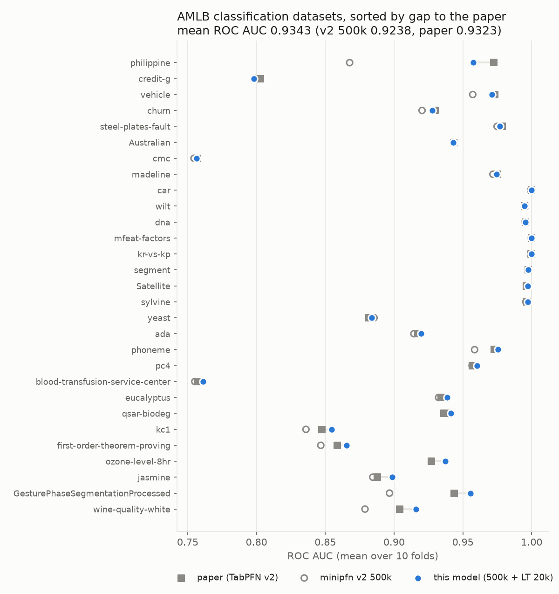

# minipfn TabPFN-2.5 classifier (reproduction)

A from-scratch reimplementation of the TabPFN-2.5 classifier ([TabPFN-2.5: Advancing the State of the Art in Tabular Foundation Models](https://arxiv.org/abs/2511.08667), 2025). It applies the architecture changes that report lists to our TabPFN v2 reimplementation, then trains on the open TabICL prior. Code: [Aiden-Jeon/minipfn](https://github.com/Aiden-Jeon/minipfn) (model `src/minipfn/models/cell_transformer.py`, settings `src/minipfn/recipes/tabpfn_v2.py`).

This is not the official TabPFN-2.5 checkpoint, and it uses no official code or weights. The official weights are under the TABPFN-2.5 License; see [PriorLabs/TabPFN](https://github.com/PriorLabs/TabPFN). The report does not publish the model width, prior details or training recipe, so those parts are our own choices (marked below).

## Model

- Architecture: the TabPFN v2 Transformer with the four TabPFN-2.5 changes, 14,335,306 parameters:
  - 24 layers (v2: 12)
  - each token holds 3 features (v2: 2)
  - 64 learned "thinking" rows, placed before the training rows; every row attends to them. How they enter the model is not described in the report, so this placement is our choice
  - emsize 192, 6 heads, MLP 4× emsize, post-LayerNorm without affine parameters (kept from v2; the report does not give them)
  - each layer runs attention across features, then across rows
- Inputs: up to 10 classes, any number of features and rows. Training covered up to 500 features and up to 8,192 training rows (see Training).
- Prior: the TabICL graph SCM prior ([soda-inria/tabicl](https://github.com/soda-inria/tabicl)) with the TabPFN v2 table-size rules, then a short stage on larger tables.
- Inference: an ensemble of 4 members. Each member shuffles features and classes and adds a random row-identifier column. Members alternate between quantile features plus SVD components and robust scaling with soft clipping (RealMLP-style: (x − median) / IQR, then x / √(1 + (x/3)²)). The report names robust scaling and soft clipping without details, so this is our reading. Categorical columns with at most 20 categories are one-hot encoded in every member (`one_hot="all"`), as long as the table stays within the feature limit. Softmax temperature is 0.9. These settings ship in `config.json` (`inference`).

## Training

Two stages, both with batch 64 tables, bf16 and gradient clipping 1.0.

1. **Prior-fitting, 500k steps** at the v2 paper's table sizes: 1–2,048 training rows plus 128 held-out rows, 1–160 features, fewer than 75,000 cells, missing values in 30% of the tables.
   - Adam at lr 2e-4, 10k warmup steps, cosine schedule over 2M steps (stopped at 500k).
   - QK-clip τ = 3000 from step 100k (see below).
   - The loss collapsed suddenly 13 times. Each time a guard rewound to a healthy state saved 2k–4k steps earlier and resumed on fresh data. From 300k each rewind also halves the base lr, which reached its floor of 2.5e-5 at 372k.
2. **Long tables, 20k steps**, starting from the 500k weights with a fresh optimizer: training rows log-uniform in 512–8,192, up to 500 features, fewer than 400,000 cells. Adam at lr 5e-5, 1k warmup, cosine to 0. The report only says the prior was scaled to more rows and features; the sizes and length here are ours. No collapses.

Compute: 8×H100 for 0–100k, 16×H100 for 100k–300k, 32×H100 for 300k–500k, and 16×H100 for the long-table stage. About 46 hours of wall-clock time, roughly 810 H100-hours (not counting short timing runs).

**QK-clip.** Row-attention heads can grow their query–key logits without limit until all weight goes to one row (an attention sink). Layer inputs come out of a LayerNorm, so a head's logits are bounded by σ_max(W_qᵀW_k)·E/√d (E = emsize). Every 50 steps, any head whose bound exceeds τ has its W_q and W_k scaled down to meet it. The bound had reached about 2,500 by 100k, so τ was set to 3000 to stop further growth without cutting the trained attention; it started clipping at about 230k. This changes training only.

Figures and numbers on this card come from checkpoint `runs:/62eab3b975c545689f7fa50488deb821/checkpoints/step_0020000.pt` (long tables), which started from `runs:/1bcc8d8dfbdb4cc695e1d8f2e78ebbe9/checkpoints/step_0500000.pt`. Train CE is the mean over 1,000 steps; every step samples new prior tables. Val CE is computed every 5,000 steps on fixed prior tables: 64 at the paper sizes (final 0.705) and 32 long tables in the second stage (final 0.499). The two val sets differ, so their values are not comparable. The spike near 445k is a collapse that the guard rewound.



## Results

### TabPFN v2 benchmark

The 29 AMLB classification datasets from the TabPFN v2 paper. Each score is the mean ROC AUC over the 10 OpenML folds. The reference values are the TabPFN v2 paper's (Supplementary Table 1, default settings); the 2.5 report has no per-dataset table for this suite. "minipfn v2" is our TabPFN v2 reimplementation trained the same way ([aiden-jeon/minipfn-tabpfn-v2-classifier](https://huggingface.co/aiden-jeon/minipfn-tabpfn-v2-classifier)).

| Checkpoint | Mean ROC AUC | minipfn v2, same step |
| --- | --- | --- |
| 100k steps | 0.9191 | 0.9175 |
| 200k steps | 0.9279 | 0.9225 |
| 300k steps | 0.9291 | 0.9208 |
| 400k steps | 0.9322 | 0.9197 |
| 500k steps | 0.9325 | 0.9238 |
| 500k + long tables 10k | 0.9336 | |
| **500k + long tables 20k (this model)** | **0.9343** | |
| TabPFN v2 paper | 0.9323 | |



This model matches or beats the paper on 18 of 29 datasets. The largest remaining gaps are philippine (5,832 rows × 308 features, −0.015) and credit-g (−0.005); no other dataset is more than 0.0025 below.

The long-table stage helped most where tables are large: +0.0026 on the 16 datasets with more than 2,048 training rows, +0.0048 on the 5 with more than 100 features, and +0.0008 on the rest. philippine rose by 0.023.

The architecture, not the preprocessing, carries the gain over minipfn v2: scoring the v2 500k checkpoint with this card's members (quantile + robust) changes its mean only from 0.9238 to 0.9240.



### TabArena-Lite

[TabArena-Lite](https://huggingface.co/spaces/TabArena/leaderboard) (51 datasets, one split each), scored the way the public leaderboard is: Elo against the leaderboard's method pool, with RandomForest (default) at 1000. The classifier and the regressor run together, so this table is the same on both cards. Splits above the model's size limit (50,000 training rows, 2,000 features, 10 classes) are not run; as on the leaderboard, they take RandomForest (default)'s result ("imputed"). Every method on the public leaderboard is 8-fold bagged; this model is fit once per split.

| Method | Elo | Imputed splits |
| --- | --- | --- |
| **minipfn TabPFN-2.5 (this model)** | **1436** (+53/−64) | 7.8% |
| minipfn TabPFN v2 | 1221 | 35.3% |
| TabPFNv2 (default), public | 1224 | |
| RealTabPFN-2.5 (default), public | 1514 | |
| TabICLv2 (default), public | 1560 | |

This model places 21st of 99 methods. By problem type its Elo is 1445 (binary), 1457 (multiclass) and 1546 (regression). It beats TabPFNv2 (default) on 73% of the splits, CatBoost (default) and tuned + ensembled XGBoost on 65%, and RealTabPFN-2.5 (default) on 43%.

Part of the gain over minipfn v2 comes from the larger size limit: 14 datasets that v2 has to impute run here. On the 33 splits both models run, this model has the lower error on 26 (geometric mean error ratio 0.90): 23 of 26 classification splits but only 3 of 7 regression splits.

### BeyondArena

BeyondArena core2k (2,000 splits from 142 datasets), scored like its public leaderboard with XGBoost (default) at 1000. Splits above the size limit, and the 5 that ran out of GPU memory (see Limitations), take RandomForest (default)'s result: 8.2% of the splits (minipfn v2: 15.8%).

| Method | Elo |
| --- | --- |
| TabICLv2 (default), public | 1172 |
| RealTabPFN-2.5 (default), public | 1143 |
| **minipfn TabPFN-2.5 (this model)** | **1096** (+29/−32) |
| XGBoost (tuned), public | 1092 |
| minipfn TabPFN v2 | 1007 |
| XGBoost (default), public | 1000 |

This model places 25th of 41 methods (minipfn v2: 30th). It is strongest on tiny and small tables (Elo 1269 and 1227) and random splits (1174), and weakest on high-cardinality categorical features (715), temporal splits (823), text features (876) and high-dimensional tables (908). On the 1,685 splits both minipfn models run, this model has the lower error on 1,027 and the higher on 646 (geometric mean error ratio 0.98).

## Limitations

- **No real-data fine-tuning.** Real-TabPFN-2.5 continues training on real datasets; this model is trained on the synthetic prior only.
- **Recipe differs from the report.** Model width, thinking-row placement, the robust member, QK-clip and the long-table stage are our choices; the report does not give them.
- **Frequent collapses.** The 24-layer classifier collapsed 13 times during prior-fitting (minipfn v2: 4). The guard and the lr halving kept training on track, but the cause is not fixed.
- **GPU memory near the size limit.** Inference on the largest tables inside the 50,000-row × 2,000-feature limit can run out of memory on an 80 GB H100: 5 BeyondArena splits (santander_customer_satisfaction, anes_voting_2026, labour_inspection_compliance) failed this way.
- **Classification only.** The regressor is a separate model: [aiden-jeon/minipfn-tabpfn-v2-5-regressor](https://huggingface.co/aiden-jeon/minipfn-tabpfn-v2-5-regressor).

## Usage

```bash
uv pip install "minipfn @ git+https://github.com/Aiden-Jeon/minipfn"
```

```python
from minipfn import TabPFNv2_5Classifier

# downloads aiden-jeon/minipfn-tabpfn-v2-5-classifier
# x_train can be a pandas DataFrame with categorical columns
clf = TabPFNv2_5Classifier().fit(x_train, y_train)
proba = clf.predict_proba(x_test)  # (n_test, n_classes), columns in clf.classes_ order
```

`fit` does not train weights. It fits each ensemble member's preprocessing on the training rows, which then serve as context at prediction time. To reproduce the benchmark (downloads the OpenML tasks):

```bash
uv run python scripts/tabpfn_v2/eval.py --suite classification \
  --classifier-path hf://aiden-jeon/minipfn-tabpfn-v2-5-classifier
```

## Intermediate checkpoints

The prior-fitting checkpoints from the Results table are kept as branches of this repo. Each branch holds the weights, config and a short README that points back here; this card on `main` describes all of them.

| Branch | Training checkpoint | Mean ROC AUC |
| --- | --- | --- |
| `step-100k` | `runs:/00e8ae4c5cbf4de1a89039b032fabb72/checkpoints/step_0100000.pt` | 0.9191 |
| `step-200k` | `runs:/e18bbf4869644bae954190262751173a/checkpoints/step_0200000.pt` | 0.9279 |
| `step-300k` | `runs:/78ed9e4fff3941b7a5b282afe0ed27fc/checkpoints/step_0300000.pt` | 0.9291 |
| `step-400k` | `runs:/edc26725fa8b40ee876fc0a6b0f22d99/checkpoints/step_0400000.pt` | 0.9322 |
| `step-500k` | `runs:/1bcc8d8dfbdb4cc695e1d8f2e78ebbe9/checkpoints/step_0500000.pt` | 0.9325 |
| `main` (500k + long tables 20k) | `runs:/62eab3b975c545689f7fa50488deb821/checkpoints/step_0020000.pt` | 0.9343 |

```python
clf = TabPFNv2_5Classifier("aiden-jeon/minipfn-tabpfn-v2-5-classifier@step-500k")
```

In the benchmark script, write the branch after `@`: `--classifier-path hf://aiden-jeon/minipfn-tabpfn-v2-5-classifier@step-500k`.

## Files

- `model.safetensors`: weights
- `config.json`: model size (`CellTransformerConfig` fields), task, inference settings, and the training checkpoint the weights came from
- `images/`: figures used in this card

## License

Apache-2.0. The training data were generated with the TabICL prior (BSD-3-Clause); no TabICL code is included here. No TabPFN-2.5 code or weights are included.

## Citation

```bibtex
@article{grinsztajn2025tabpfn25,
  title   = {{TabPFN-2.5}: Advancing the State of the Art in Tabular Foundation Models},
  author  = {Grinsztajn, L{\'e}o and others},
  journal = {arXiv preprint arXiv:2511.08667},
  year    = {2025}
}

@article{hollmann2025tabpfn,
  title   = {Accurate predictions on small data with a tabular foundation model},
  author  = {Hollmann, Noah and M{\"u}ller, Samuel and Purucker, Lennart and Krishnakumar, Arjun and K{\"o}rfer, Max and Hoo, Shi Bin and Schirrmeister, Robin Tibor and Hutter, Frank},
  journal = {Nature},
  volume  = {637},
  pages   = {319--326},
  year    = {2025},
  doi     = {10.1038/s41586-024-08328-6}
}

@inproceedings{qu2025tabicl,
  title     = {{TabICL}: A Tabular Foundation Model for In-Context Learning on Large Data},
  author    = {Qu, Jingang and Holzm{\"u}ller, David and Varoquaux, Ga{\"e}l and Le Morvan, Marine},
  booktitle = {International Conference on Machine Learning},
  year      = {2025}
}
```
