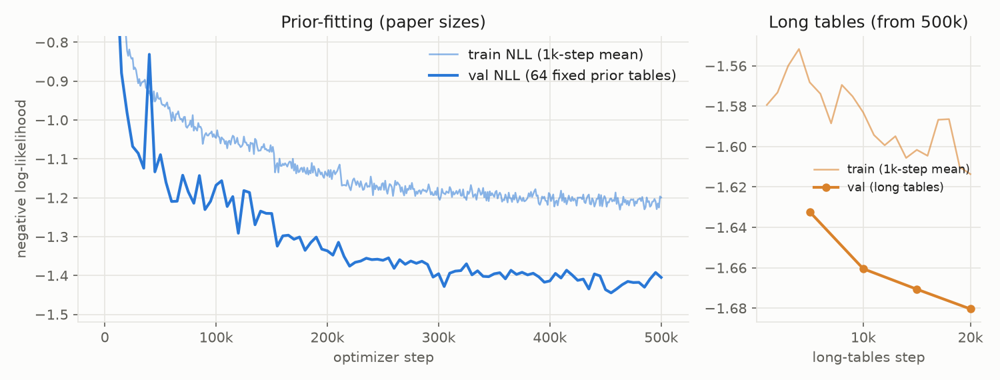
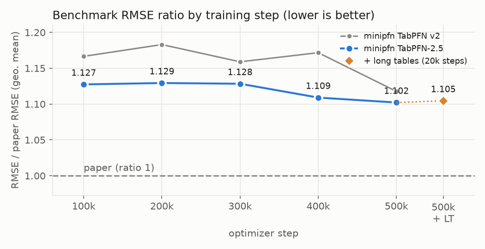
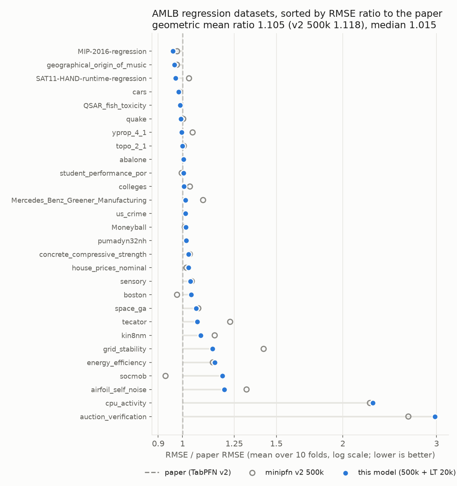

# minipfn TabPFN-2.5 regressor (reproduction)

A from-scratch reimplementation of the TabPFN-2.5 regressor ([TabPFN-2.5: Advancing the State of the Art in Tabular Foundation Models](https://arxiv.org/abs/2511.08667), 2025). It applies the architecture changes that report lists to our TabPFN v2 reimplementation, then trains on the open TabICL prior. Code: [Aiden-Jeon/minipfn](https://github.com/Aiden-Jeon/minipfn) (model `src/minipfn/models/cell_transformer.py`, settings `src/minipfn/recipes/tabpfn_v2.py`).

This is not the official TabPFN-2.5 checkpoint, and it uses no official code or weights. The official weights are under the TABPFN-2.5 License; see [PriorLabs/TabPFN](https://github.com/PriorLabs/TabPFN). The report does not publish the model width, prior details or training recipe, so those parts are our own choices (marked below). The classifier is a separate model: [aiden-jeon/minipfn-tabpfn-v2-5-classifier](https://huggingface.co/aiden-jeon/minipfn-tabpfn-v2-5-classifier).

## Model

- Architecture: the TabPFN v2 Transformer with the four TabPFN-2.5 changes, 14,670,728 parameters:
  - 18 layers (v2: 12)
  - each token holds 3 features (v2: 2)
  - 64 learned "thinking" rows, placed before the training rows; every row attends to them. How they enter the model is not described in the report, so this placement is our choice
  - the cell encoder is a 2-layer MLP (Linear → GELU → Linear, hidden size emsize) instead of a linear layer
  - emsize 192, 6 heads, MLP 4× emsize, post-LayerNorm without affine parameters (kept from v2; the report does not give them)
- Output: a bar distribution over 5,000 buckets of the standardized target, with half-normal tails. The bucket borders are quantiles of prior targets and ship with the weights (`borders` in `model.safetensors`).
- Inputs: any number of features and rows. Training covered up to 500 features and up to 8,192 training rows (see Training).
- Prior: the TabICL graph SCM prior ([soda-inria/tabicl](https://github.com/soda-inria/tabicl)) in regression mode with the TabPFN v2 table-size rules, then a short stage on larger tables.
- Inference: an ensemble of 8 members. Each member shuffles features and adds a random row-identifier column. Members alternate between quantile features plus SVD components and robust scaling with soft clipping (RealMLP-style: (x − median) / IQR, then x / √(1 + (x/3)²)); half of them also power-transform the target. The report names robust scaling and soft clipping without details, so this is our reading. Each member's predicted distribution is mapped back to the original target scale and the predictions are averaged. Categorical columns with at most 20 categories are one-hot encoded in every member (`one_hot="all"`), as long as the table stays within the feature limit. These settings ship in `config.json` (`inference`).

## Training

Two stages, both with batch 64 tables, bf16 and gradient clipping 1.0.

1. **Prior-fitting, 500k steps** at the v2 paper's table sizes: 1–2,048 training rows plus 128 held-out rows, 1–160 features, fewer than 75,000 cells, missing values in 30% of the tables.
   - Adam at lr 2e-4, 10k warmup steps, cosine schedule over 2M steps (stopped at 500k).
   - The loss collapsed twice (at 155k and 216k). Each time a guard rewound to a healthy state saved 2k–4k steps earlier, halved the base lr and resumed on fresh data. The base lr was 5e-5 from 212k on.
2. **Long tables, 20k steps**, starting from the 500k weights with a fresh optimizer: training rows log-uniform in 512–8,192, up to 500 features, fewer than 400,000 cells. Adam at lr 5e-5, 1k warmup, cosine to 0. The report only says the prior was scaled to more rows and features; the sizes and length here are ours. No collapses.

Compute: 8×H100 for 0–100k, 16×H100 for 100k–300k, 32×H100 for 300k–500k, and 16×H100 for the long-table stage. About 37 hours of wall-clock time, roughly 650 H100-hours (not counting short timing runs).

Two training changes from our TabPFN v2 regressor carry over; neither is in the paper:

- **Dequantized targets.** Held-out targets that repeat within a table are spread uniformly over the 100 neighbouring buckets during training, so a discrete target does not push the output layer to grow without bound. Validation uses the original targets.
- **QK-clip (τ = 250).** Row-attention heads can grow their query–key logits until all weight goes to one row (an attention sink). Every 50 steps, any head whose logit bound σ_max(W_qᵀW_k)·E/√d exceeds 250 has its W_q and W_k scaled down to meet it. The bound reached 250 at about 30k and stayed capped. This changes training only.

Figures and numbers on this card come from checkpoint `runs:/544cea90fe364d3c8bca1880e4e2aa59/checkpoints/step_0020000.pt` (long tables), which started from `runs:/837ee152f75e42419f47beb9cbdbc43c/checkpoints/step_0500000.pt`. Train NLL is the mean over 1,000 steps; every step samples new prior tables. Val NLL is computed every 5,000 steps on fixed prior tables: 64 at the paper sizes (final −1.405) and 32 long tables in the second stage (final −1.680). The two val sets differ, so their values are not comparable.



## Results

### TabPFN v2 benchmark

The 28 regression datasets from the TabPFN v2 paper. Each score is the RMSE averaged over the 10 OpenML folds. The reference values are the TabPFN v2 paper's (Supplementary Table 2, default settings); the 2.5 report has no per-dataset table for this suite. RMSE has a different unit on every dataset, so a plain mean is dominated by a few large-scale targets. The main summary is the RMSE ratio to the paper per dataset (below 1 is better than the paper), combined as a geometric mean. "minipfn v2" is our TabPFN v2 reimplementation ([aiden-jeon/minipfn-tabpfn-v2-regressor](https://huggingface.co/aiden-jeon/minipfn-tabpfn-v2-regressor)).

| Checkpoint | RMSE ratio, geo. mean | RMSE ratio, median | Datasets within 1.1× | Mean neg RMSE | minipfn v2 geo. mean, same step |
| --- | --- | --- | --- | --- | --- |
| 100k steps | 1.127 | 1.028 | 20/28 | −1767.5 | 1.167 |
| 200k steps | 1.129 | 1.037 | 21/28 | −1743.0 | 1.183 |
| 300k steps | 1.128 | 1.019 | 20/28 | −1750.5 | 1.159 |
| 400k steps | 1.109 | 1.014 | 22/28 | −1704.9 | 1.172 |
| 500k steps | **1.102** | 1.018 | **23/28** | −1716.5 | 1.118 |
| 500k + long tables 10k | 1.112 | 1.016 | 21/28 | −1711.8 | |
| **500k + long tables 20k (this model)** | 1.105 | **1.015** | 22/28 | **−1704.0** | |
| TabPFN v2 paper | 1 | 1 | 28/28 | −1685.6 | |



Against minipfn v2 at 500k, this model's RMSE is 1.2% lower (geometric mean of the per-dataset ratio), better on 11 datasets and worse on 4. The architecture, not the preprocessing, carries the gain: scoring the v2 500k checkpoint with this card's members (quantile + robust) changes its RMSE ratio only from 1.118 to 1.119.

The long-table stage leaves the overall ratio flat (1.102 → 1.105). It lowers RMSE on the 11 datasets with more than 2,048 training rows (−0.6%) and the 8 with more than 100 features (−1.1%), and raises it on the 17 smaller ones (+0.8%), mostly auction_verification (+11%) and socmob (+9.5%). This card's `main` is the long-table checkpoint because it covers larger tables; the 500k checkpoint is the `step-500k` branch.

On 8 datasets this model beats the paper's RMSE (MIP-2016-regression 0.96×, geographical_origin_of_music 0.97×, SAT11-HAND-runtime-regression 0.97×, cars 0.98×). Most of the gap comes from a few datasets:

| Dataset | RMSE ratio |
| --- | --- |
| auction_verification | 2.98 |
| cpu_activity | 2.28 |
| airfoil_self_noise | 1.20 |
| socmob | 1.19 |
| energy_efficiency | 1.15 |



### TabArena-Lite

[TabArena-Lite](https://huggingface.co/spaces/TabArena/leaderboard) (51 datasets, one split each), scored the way the public leaderboard is: Elo against the leaderboard's method pool, with RandomForest (default) at 1000. The classifier and the regressor run together, so this table is the same on both cards. Splits above the model's size limit (50,000 training rows, 2,000 features, 10 classes) are not run; as on the leaderboard, they take RandomForest (default)'s result ("imputed"). Every method on the public leaderboard is 8-fold bagged; this model is fit once per split.

| Method | Elo | Imputed splits |
| --- | --- | --- |
| **minipfn TabPFN-2.5 (this model)** | **1436** (+53/−64) | 7.8% |
| minipfn TabPFN v2 | 1221 | 35.3% |
| TabPFNv2 (default), public | 1224 | |
| RealTabPFN-2.5 (default), public | 1514 | |
| TabICLv2 (default), public | 1560 | |

This model places 21st of 99 methods. By problem type its Elo is 1445 (binary), 1457 (multiclass) and 1546 (regression). It beats TabPFNv2 (default) on 73% of the splits, CatBoost (default) and tuned + ensembled XGBoost on 65%, and RealTabPFN-2.5 (default) on 43%.

Part of the gain over minipfn v2 comes from the larger size limit: 14 datasets that v2 has to impute run here. On the 33 splits both models run, this model has the lower error on 26 (geometric mean error ratio 0.90): 23 of 26 classification splits but only 3 of 7 regression splits.

## Limitations

- **No real-data fine-tuning.** Real-TabPFN-2.5 continues training on real datasets; this model is trained on the synthetic prior only.
- **Recipe differs from the report.** Model width, thinking-row placement, the robust member, dequantized targets, QK-clip and the long-table stage are our choices; the report does not give them.
- **A few datasets stay far from the paper.** auction_verification and cpu_activity are 2–3× the paper's RMSE at every checkpoint, as with minipfn v2. cpu_activity also moves a lot between checkpoints (1.32× at 100k, 2.26× at 300k).
- **Regression only.** The classifier is a separate model: [aiden-jeon/minipfn-tabpfn-v2-5-classifier](https://huggingface.co/aiden-jeon/minipfn-tabpfn-v2-5-classifier).

## Usage

```bash
uv pip install "minipfn @ git+https://github.com/Aiden-Jeon/minipfn"
```

```python
from minipfn import TabPFNv2_5Regressor

# downloads aiden-jeon/minipfn-tabpfn-v2-5-regressor (weights and bucket borders)
reg = TabPFNv2_5Regressor().fit(x_train, y_train)
y_pred = reg.predict(x_test)  # mean of the predicted distribution
```

`fit` does not train weights. It fits each ensemble member's preprocessing on the training rows, which then serve as context at prediction time. To reproduce the benchmark (downloads the OpenML tasks):

```bash
uv run python scripts/tabpfn_v2/eval.py --suite regression \
  --regressor-path hf://aiden-jeon/minipfn-tabpfn-v2-5-regressor
```

## Intermediate checkpoints

The prior-fitting checkpoints from the Results table are kept as branches of this repo. Each branch holds the weights, config and a short README that points back here; this card on `main` describes all of them.

| Branch | Training checkpoint | RMSE ratio, geo. mean |
| --- | --- | --- |
| `step-100k` | `runs:/a70966f2a47f428f9261a33a6e6e2662/checkpoints/step_0100000.pt` | 1.127 |
| `step-200k` | `runs:/254f42f84f4b46b9ad478dd958503ccd/checkpoints/step_0200000.pt` | 1.129 |
| `step-300k` | `runs:/0d55244e39c54ad8b4f1dfeccd89f50e/checkpoints/step_0300000.pt` | 1.128 |
| `step-400k` | `runs:/69f62dfc19eb41159924949f1d75fdbd/checkpoints/step_0400000.pt` | 1.109 |
| `step-500k` | `runs:/837ee152f75e42419f47beb9cbdbc43c/checkpoints/step_0500000.pt` | 1.102 |
| `main` (500k + long tables 20k) | `runs:/544cea90fe364d3c8bca1880e4e2aa59/checkpoints/step_0020000.pt` | 1.105 |

```python
reg = TabPFNv2_5Regressor("aiden-jeon/minipfn-tabpfn-v2-5-regressor@step-500k")
```

In the benchmark script, write the branch after `@`: `--regressor-path hf://aiden-jeon/minipfn-tabpfn-v2-5-regressor@step-500k`.

## Files

- `model.safetensors`: weights and bucket borders
- `config.json`: model size (`CellTransformerConfig` fields), task, inference settings, and the training checkpoint the weights came from
- `images/`: figures used in this card

## License

Apache-2.0. The training data were generated with the TabICL prior (BSD-3-Clause); no TabICL code is included here. No TabPFN-2.5 code or weights are included.

## Citation

```bibtex
@article{grinsztajn2025tabpfn25,
  title   = {{TabPFN-2.5}: Advancing the State of the Art in Tabular Foundation Models},
  author  = {Grinsztajn, L{\'e}o and others},
  journal = {arXiv preprint arXiv:2511.08667},
  year    = {2025}
}

@article{hollmann2025tabpfn,
  title   = {Accurate predictions on small data with a tabular foundation model},
  author  = {Hollmann, Noah and M{\"u}ller, Samuel and Purucker, Lennart and Krishnakumar, Arjun and K{\"o}rfer, Max and Hoo, Shi Bin and Schirrmeister, Robin Tibor and Hutter, Frank},
  journal = {Nature},
  volume  = {637},
  pages   = {319--326},
  year    = {2025},
  doi     = {10.1038/s41586-024-08328-6}
}

@inproceedings{qu2025tabicl,
  title     = {{TabICL}: A Tabular Foundation Model for In-Context Learning on Large Data},
  author    = {Qu, Jingang and Holzm{\"u}ller, David and Varoquaux, Ga{\"e}l and Le Morvan, Marine},
  booktitle = {International Conference on Machine Learning},
  year      = {2025}
}
```
