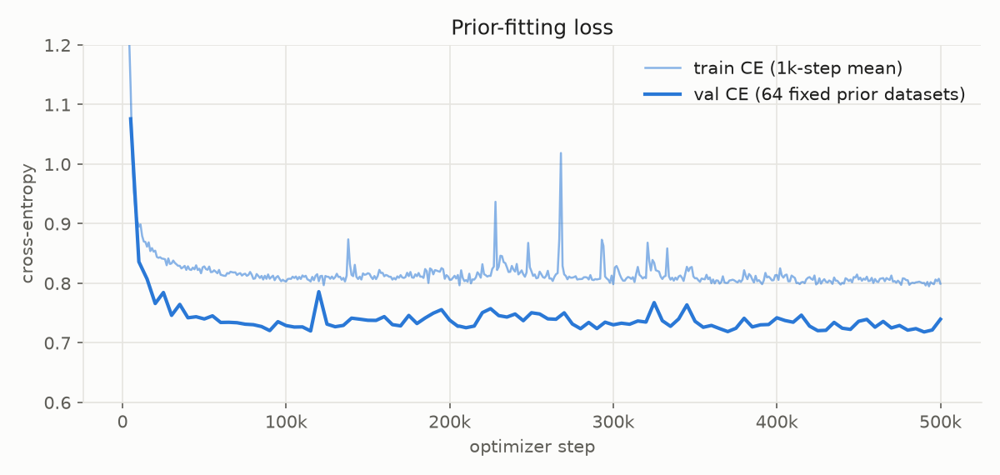
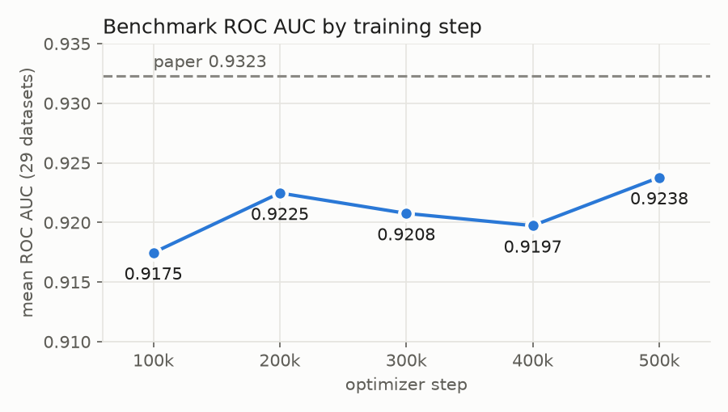
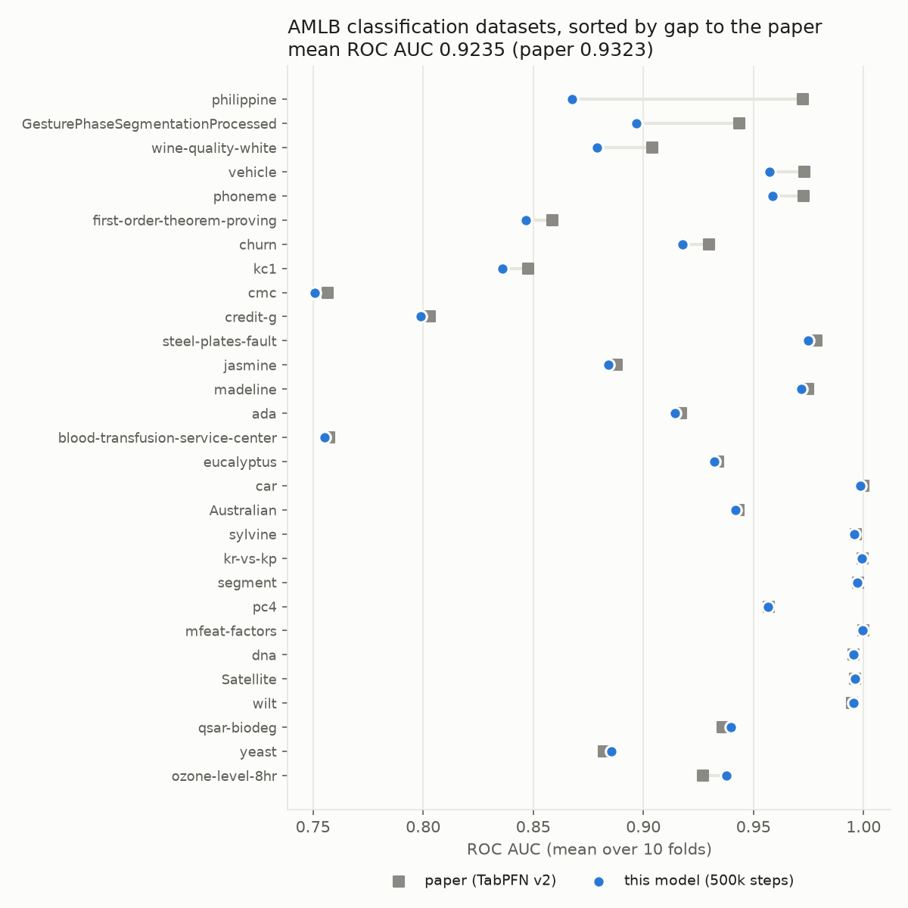

# minipfn TabPFN v2 classifier (reproduction)

A from-scratch reimplementation of the TabPFN v2 classifier (Hollmann et al., [Accurate predictions on small data with a tabular foundation model](https://doi.org/10.1038/s41586-024-08328-6), Nature 637, 2025). The model and inference follow the paper's Methods, and the training data come from the open TabICL prior. Code: [Aiden-Jeon/minipfn](https://github.com/Aiden-Jeon/minipfn) (model `src/minipfn/models/tabpfn_v2.py`, training settings `src/minipfn/recipes/tabpfn_v2.py`).

This is not the official TabPFN v2 checkpoint, and it uses no official code or weights. For the official models see [PriorLabs/TabPFN](https://github.com/PriorLabs/TabPFN).

## Model

- Architecture: TabPFN v2 Transformer with 7,244,746 parameters:
  - 12 layers, emsize 192, 6 heads, MLP 4× emsize
  - each layer runs attention across features, then across rows
  - post-LayerNorm without affine parameters
  - each token holds 2 features
- Inputs: up to 10 classes, any number of features and rows. Training covered up to 160 features and up to 2,048 training rows.
- Prior: the TabICL graph SCM prior ([soda-inria/tabicl](https://github.com/soda-inria/tabicl)), with the paper's table-size rules on top:
  - training rows uniform in 1–2,048, plus 128 held-out rows
  - Beta(0.95, 8.0) features scaled to 1–160
  - fewer than 75,000 cells per table
  - in 30% of the tables, values go missing at random at a rate of 0–30%
- Inference (paper defaults): an ensemble of 4 members. Each member shuffles features and classes and adds a random row-identifier column. Members alternate between quantile features plus SVD components and a Yeo-Johnson power transform. Categorical columns with at most 20 categories are one-hot encoded in every member (`one_hot="all"`, the default), as long as the table stays within 160 columns. Softmax temperature is 0.9.

## Training

- 500,000 steps, batch 64 tables.
- Adam at lr 2e-4, with 10k warmup steps and a cosine schedule over 2M steps. Training stopped at 500k, where the lr was still 1.7e-4.
- bf16, gradient clipping 1.0.
- Compute: 8×H100 for steps 0–300k and 16×H100 for 300k–500k. About 35 hours of wall-clock time, roughly 370 H100-hours.
- The loss collapsed suddenly 4 times. Each time, an automatic guard rewound to a healthy state saved 2k–4k steps earlier and resumed on fresh data.

Figures and numbers on this card come from checkpoint `runs:/a1df9e34774d49e7869eb381bf65509b/checkpoints/step_0500000.pt`. It was trained in 100k-step chunks, each resuming the previous one. Train CE is the mean over 1,000 steps; every step samples new prior tables. Val CE is computed on 64 fixed prior tables every 5,000 steps. Final val CE is 0.740.



## Results

The benchmark is the paper's 29 AMLB classification datasets. Each score is the mean ROC AUC over the 10 OpenML folds. Paper values come from Supplementary Table 1 (TabPFN v2, default settings). All figures use the default inference settings (`one_hot="all"`). The last column keeps categorical columns as ordinal codes (`one_hot="off"`); only the 9 datasets with categorical columns differ.

| Checkpoint | Mean ROC AUC | With `one_hot="off"` |
| --- | --- | --- |
| 100k steps | 0.9175 | 0.9169 |
| 200k steps | 0.9225 | 0.9222 |
| 300k steps | 0.9208 | 0.9203 |
| 400k steps | 0.9197 | 0.9196 |
| **500k steps (this model)** | **0.9238** | 0.9235 |
| Paper | 0.9323 | |



Most of the gap comes from a few datasets:

| Dataset | Gap |
| --- | --- |
| philippine (5,832 rows × 308 features) | −0.105 |
| GesturePhaseSegmentationProcessed | −0.047 |
| wine-quality-white | −0.025 |

Without philippine, GesturePhaseSegmentationProcessed, wine-quality-white, kc1 and first-order-theorem-proving, the mean gap is −0.002.



## Limitations

- **philippine** stays about 0.10 below the paper at every checkpoint from 100k to 500k. Two inference-time checks did not change it: capping the columns each ensemble member sees (500, 300 or 160) and capping its training rows (4,096 or 2,048). The cause is unknown.
- **Behavior can shift between checkpoints.** On mfeat-factors, the 300k and 400k checkpoints score 0.94 on all 10 folds; 200k and 500k score 1.00.
- **Row attention grows sharp during training.** Some heads come to put nearly all their weight on a single row (an attention sink). This is the likely source of the collapses that the guard rewound.
- **Classification only.** The regressor is a separate model: [aiden-jeon/minipfn-tabpfn-v2-regressor](https://huggingface.co/aiden-jeon/minipfn-tabpfn-v2-regressor).

## Usage

```bash
uv pip install "minipfn @ git+https://github.com/Aiden-Jeon/minipfn"
```

```python
from minipfn.hub import from_pretrained
from minipfn.recipes.tabpfn_v2 import TabPFNv2Classifier

model, _ = from_pretrained("aiden-jeon/minipfn-tabpfn-v2-classifier")
# x_train can be a pandas DataFrame with categorical columns
clf = TabPFNv2Classifier(model).fit(x_train, y_train)
proba = clf.predict_proba(x_test)  # (n_test, n_classes), columns in clf.classes_ order
```

`fit` does not train weights. It fits each ensemble member's preprocessing on the training rows, which then serve as context at prediction time. To reproduce the benchmark (downloads the OpenML tasks):

```bash
uv run python scripts/tabpfn_v2/eval.py --suite classification \
  --classifier-path hf://aiden-jeon/minipfn-tabpfn-v2-classifier
```

Add `--one-hot off,power,all` to also score the other one-hot modes. The headline numbers stay those of the default mode.

## Intermediate checkpoints

The checkpoints from the Results table are kept as branches of this repo. Each branch holds the weights, config and a short README that points back here; this card on `main` describes all of them.

| Branch | Training checkpoint | Mean ROC AUC |
| --- | --- | --- |
| `step-100k` | `runs:/8e83c33e525b4477ac7ca520974b448a/checkpoints/latest.pt` | 0.9175 |
| `step-200k` | `runs:/630bf9cacfc14480b9c4a5c433f35c72/checkpoints/latest.pt` | 0.9225 |
| `step-300k` | `runs:/56838e7535724969a298245e10639d8d/checkpoints/step_0300000.pt` | 0.9208 |
| `step-400k` | `runs:/87a5aab6216e4908ad5247885fdad94f/checkpoints/step_0400000.pt` | 0.9197 |
| `main` (500k) | `runs:/a1df9e34774d49e7869eb381bf65509b/checkpoints/step_0500000.pt` | 0.9238 |

```python
model, _ = from_pretrained("aiden-jeon/minipfn-tabpfn-v2-classifier", revision="step-100k")
```

In the benchmark script, write the branch after `@`: `--classifier-path hf://aiden-jeon/minipfn-tabpfn-v2-classifier@step-100k`.

## Files

- `model.safetensors`: weights
- `config.json`: model size (`TabPFNv2Config`), task, and the training checkpoint the weights came from
- `images/`: figures used in this card

## License

Apache-2.0. The training data were generated with the TabICL prior (BSD-3-Clause); no TabICL code is included here.

## Citation

```bibtex
@article{hollmann2025tabpfn,
  title   = {Accurate predictions on small data with a tabular foundation model},
  author  = {Hollmann, Noah and M{\"u}ller, Samuel and Purucker, Lennart and Krishnakumar, Arjun and K{\"o}rfer, Max and Hoo, Shi Bin and Schirrmeister, Robin Tibor and Hutter, Frank},
  journal = {Nature},
  volume  = {637},
  pages   = {319--326},
  year    = {2025},
  doi     = {10.1038/s41586-024-08328-6}
}

@inproceedings{qu2025tabicl,
  title     = {{TabICL}: A Tabular Foundation Model for In-Context Learning on Large Data},
  author    = {Qu, Jingang and Holzm{\"u}ller, David and Varoquaux, Ga{\"e}l and Le Morvan, Marine},
  booktitle = {International Conference on Machine Learning},
  year      = {2025}
}
```
