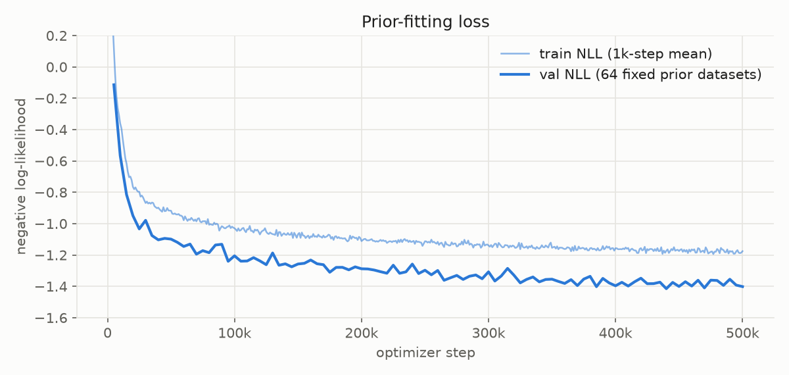
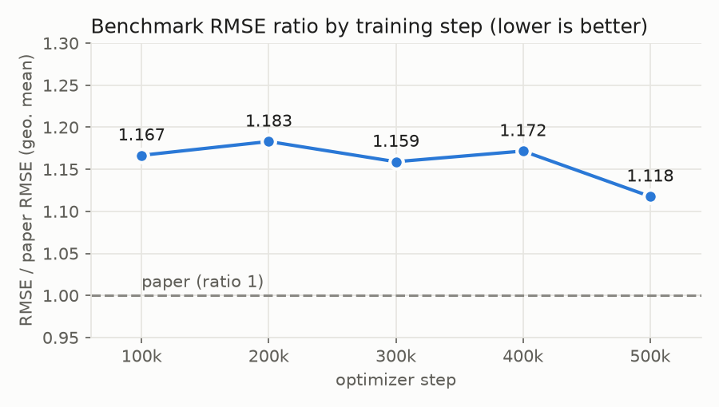
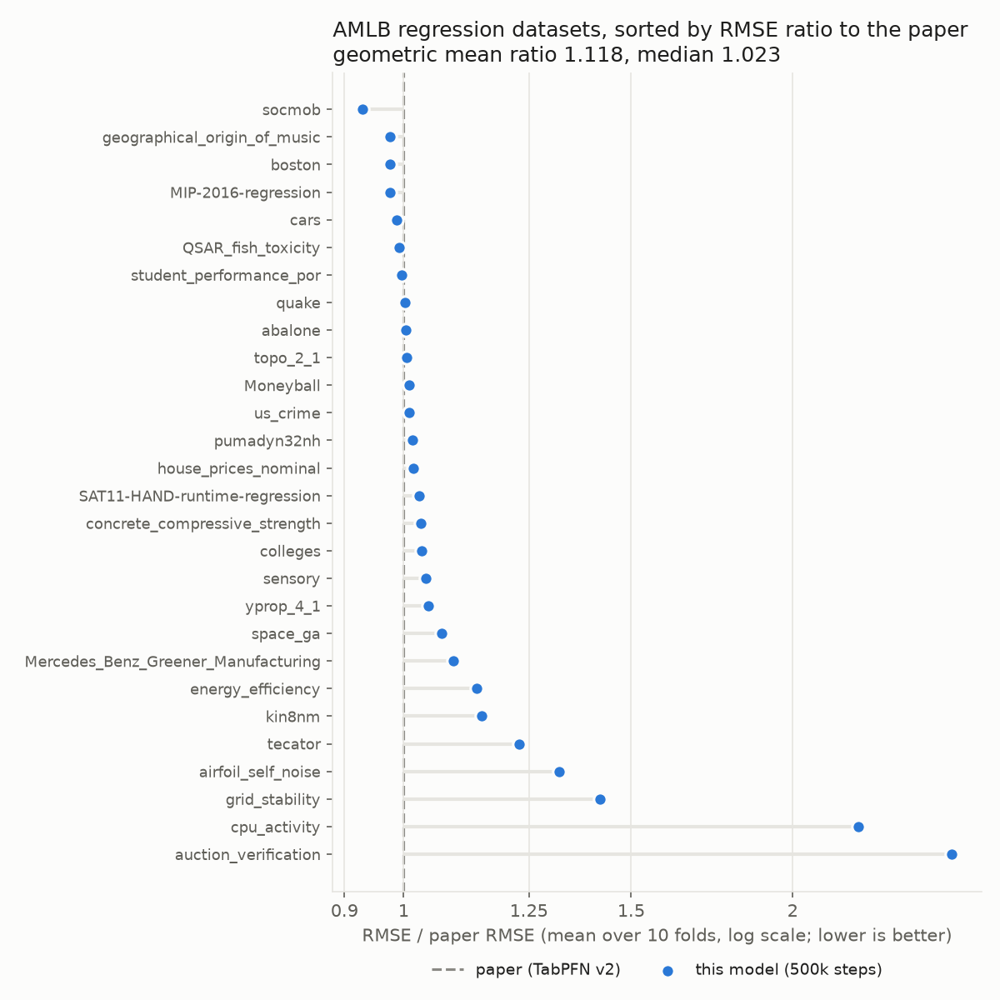

# minipfn TabPFN v2 regressor (reproduction)

A from-scratch reimplementation of the TabPFN v2 regressor (Hollmann et al., [Accurate predictions on small data with a tabular foundation model](https://doi.org/10.1038/s41586-024-08328-6), Nature 637, 2025). The model and inference follow the paper's Methods, and the training data come from the open TabICL prior. Code: [Aiden-Jeon/minipfn](https://github.com/Aiden-Jeon/minipfn) (`src/minipfn/tabpfn_v2/`).

This is not the official TabPFN v2 checkpoint, and it uses no official code or weights. For the official models see [PriorLabs/TabPFN](https://github.com/PriorLabs/TabPFN). The classifier is a separate model: [aiden-jeon/minipfn-tabpfn-v2-classifier](https://huggingface.co/aiden-jeon/minipfn-tabpfn-v2-classifier).

## Model

- Architecture: TabPFN v2 Transformer, the same as the classifier except for the output head:
  - 12 layers, emsize 192, 6 heads, MLP 4× emsize
  - each layer runs attention across features, then across rows
  - post-LayerNorm without affine parameters
  - each token holds 2 features
- Output: a bar distribution over 5,000 buckets of the standardized target, with half-normal tails. The bucket borders are quantiles of prior targets and ship with the weights (`borders` in `model.safetensors`).
- Inputs: any number of features and rows. Training covered up to 160 features and up to 2,048 training rows.
- Prior: the TabICL graph SCM prior ([soda-inria/tabicl](https://github.com/soda-inria/tabicl)) in regression mode, with the paper's table-size rules on top:
  - training rows uniform in 1–2,048, plus 128 held-out rows
  - Beta(0.95, 8.0) features scaled to 1–160
  - fewer than 75,000 cells per table
  - in 30% of the tables, values go missing at random at a rate of 0–30%
- Inference (paper defaults): an ensemble of 8 members. Each member shuffles features and adds a random row-identifier column. Members alternate between quantile features plus SVD components and a Yeo-Johnson power transform, and half of them also power-transform the target. Each member's predicted distribution is mapped back to the original target scale and the predictions are averaged. Categorical columns with at most 20 categories are one-hot encoded in every member (`one_hot="all"`, the default), as long as the table stays within 160 columns.

## Training

- 500,000 steps, batch 64 tables.
- Adam at lr 2e-4, with 10k warmup steps and a cosine schedule over 2M steps. Training stopped at 500k, where the lr was still 1.7e-4.
- bf16, gradient clipping 1.0.
- Compute: 8×H100 for steps 0–200k and 32×H100 (4 nodes) for 200k–500k. About 28 hours of wall-clock time, roughly 530 H100-hours.

Three changes that are not in the paper keep regression training stable. Earlier runs without them collapsed to a constant prediction or became unstable somewhere between 190k and 300k steps.

- **Dequantized targets.** Many prior tables have a discrete target. The loss then keeps rewarding more probability on a single bucket, and the output layer grows without bound. During training, held-out targets that repeat within a table are spread uniformly over the 100 neighbouring buckets. Validation uses the original targets.
- **QK-clip (τ = 250).** Row attention heads learn to send almost all their weight to one row (an attention sink) by growing the query–key logits without limit. Layer inputs come out of a LayerNorm, so every token has norm √E (E = emsize), and a head's logits are bounded by σ_max(W_qᵀW_k)·E/√d. Every 50 steps, any attention head whose bound exceeds 250 has its W_q and W_k scaled down to meet it. The first layer's feature attention is skipped because its inputs are not normalized. This changes only training; the architecture and inference stay as in the paper.
- **Collapse guard.** If the loss jumps and stays high, training rewinds to a healthy in-memory snapshot and continues on fresh data. It never fired in this run.

Figures and numbers on this card come from checkpoint `runs:/0b8800ff3ff741f59996c6265e2d8771/checkpoints/step_0500000.pt`. It was trained in 100k-step chunks, each resuming the previous one. Train NLL is the mean over 1,000 steps; every step samples new prior tables. Val NLL is computed on 64 fixed prior tables every 5,000 steps. Final val NLL is −1.401.



## Results

The benchmark is the paper's 28 regression datasets. Each score is the RMSE averaged over the 10 OpenML folds. Paper values come from Supplementary Table 2 (TabPFN v2, default settings). RMSE has a different unit on every dataset, so a plain mean is dominated by a few large-scale targets. The main summary is therefore the RMSE ratio to the paper per dataset (below 1 is better than the paper), combined as a geometric mean. All figures use the default inference settings (`one_hot="all"`).

| Checkpoint | RMSE ratio, geo. mean | RMSE ratio, median | Datasets within 1.1× | Mean neg RMSE |
| --- | --- | --- | --- | --- |
| 100k steps | 1.167 | 1.059 | 18/28 | −1802.8 |
| 200k steps | 1.183 | 1.057 | 20/28 | −1826.3 |
| 300k steps | 1.159 | 1.026 | 19/28 | −1822.5 |
| 400k steps | 1.172 | 1.041 | 18/28 | −1751.3 |
| **500k steps (this model)** | **1.118** | **1.023** | **21/28** | **−1706.4** |
| Paper | 1 | 1 | 28/28 | −1685.6 |



On 7 datasets this model beats the paper's RMSE (socmob 0.93×, geographical_origin_of_music, boston, MIP-2016-regression 0.98×). Most of the gap comes from four datasets:

| Dataset | RMSE ratio |
| --- | --- |
| auction_verification | 2.66 |
| cpu_activity | 2.25 |
| grid_stability | 1.42 |
| airfoil_self_noise | 1.32 |



## Limitations

- **Four datasets stay well behind the paper at every checkpoint:** auction_verification, cpu_activity, grid_stability and airfoil_self_noise. One-hot encoding does not change them. The cause is unknown; on cpu_activity, an earlier checkpoint predicted the many rows with target 0 well above their true value.
- **Training recipe differs from the paper.** Dequantized targets and QK-clip are our additions (see Training). The paper does not report needing them, so its recipe or prior may avoid the instability in another way.
- **Regression only.** The classifier is a separate model.

## Usage

```bash
uv pip install "minipfn @ git+https://github.com/Aiden-Jeon/minipfn"
```

```python
from minipfn.tabpfn_v2.hub import from_pretrained
from minipfn.tabpfn_v2.inference import TabPFNv2Regressor

model, borders = from_pretrained("aiden-jeon/minipfn-tabpfn-v2-regressor")
# x_train can be a pandas DataFrame with categorical columns
reg = TabPFNv2Regressor(model, borders).fit(x_train, y_train)
pred = reg.predict(x_test)  # (n_test,), mean of the predicted distribution
```

`fit` does not train weights. It fits each ensemble member's preprocessing on the training rows, which then serve as context at prediction time. To reproduce the benchmark (downloads the OpenML tasks):

```bash
uv run python scripts/tabpfn_v2/eval.py --suite regression \
  --regressor-path hf://aiden-jeon/minipfn-tabpfn-v2-regressor
```

Add `--one-hot off,power,all` to also score the other one-hot modes. The headline numbers stay those of the default mode.

## Intermediate checkpoints

The checkpoints from the Results table are kept as branches of this repo. Each branch holds only the weights, bucket borders and config; this card on `main` describes all of them.

| Branch | Training checkpoint | RMSE ratio, geo. mean |
| --- | --- | --- |
| `step-100k` | `runs:/332757a95eb84dd1be8024857cc38e67/checkpoints/step_0100000.pt` | 1.167 |
| `step-200k` | `runs:/907e98c6a3054eceb1804f42c4780926/checkpoints/step_0200000.pt` | 1.183 |
| `step-300k` | `runs:/5f8d224cc0da44508a4b20ada64bc404/checkpoints/step_0300000.pt` | 1.159 |
| `step-400k` | `runs:/de823880b51740259b2a4fc19ff3bb8d/checkpoints/step_0400000.pt` | 1.172 |
| `main` (500k) | `runs:/0b8800ff3ff741f59996c6265e2d8771/checkpoints/step_0500000.pt` | 1.118 |

```python
model, borders = from_pretrained("aiden-jeon/minipfn-tabpfn-v2-regressor", revision="step-100k")
```

In the benchmark script, write the branch after `@`: `--regressor-path hf://aiden-jeon/minipfn-tabpfn-v2-regressor@step-100k`.

## Files

- `model.safetensors`: weights and the 5,001 bucket borders (`borders`)
- `config.json`: model size (`TabPFNv2Config`), task, and the training checkpoint the weights came from
- `images/`: figures used in this card

## License

Apache-2.0. The training data were generated with the TabICL prior (BSD-3-Clause); no TabICL code is included here.

## Citation

```bibtex
@article{hollmann2025tabpfn,
  title   = {Accurate predictions on small data with a tabular foundation model},
  author  = {Hollmann, Noah and M{\"u}ller, Samuel and Purucker, Lennart and Krishnakumar, Arjun and K{\"o}rfer, Max and Hoo, Shi Bin and Schirrmeister, Robin Tibor and Hutter, Frank},
  journal = {Nature},
  volume  = {637},
  pages   = {319--326},
  year    = {2025},
  doi     = {10.1038/s41586-024-08328-6}
}

@inproceedings{qu2025tabicl,
  title     = {{TabICL}: A Tabular Foundation Model for In-Context Learning on Large Data},
  author    = {Qu, Jingang and Holzm{\"u}ller, David and Varoquaux, Ga{\"e}l and Le Morvan, Marine},
  booktitle = {International Conference on Machine Learning},
  year      = {2025}
}
```
