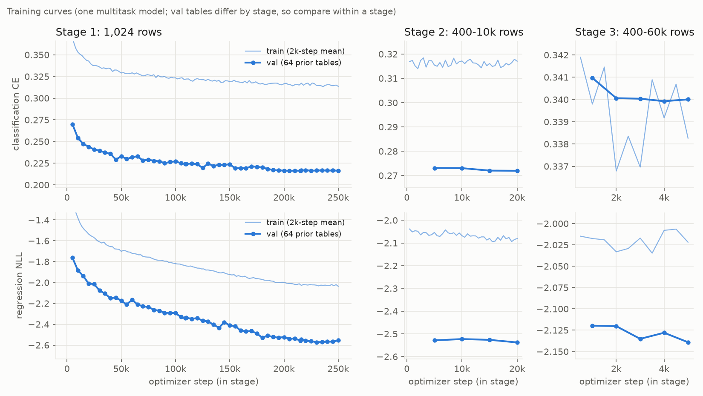
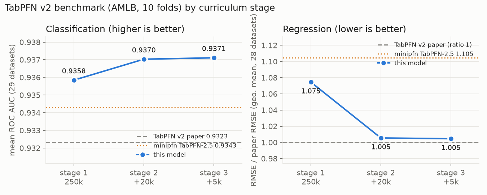
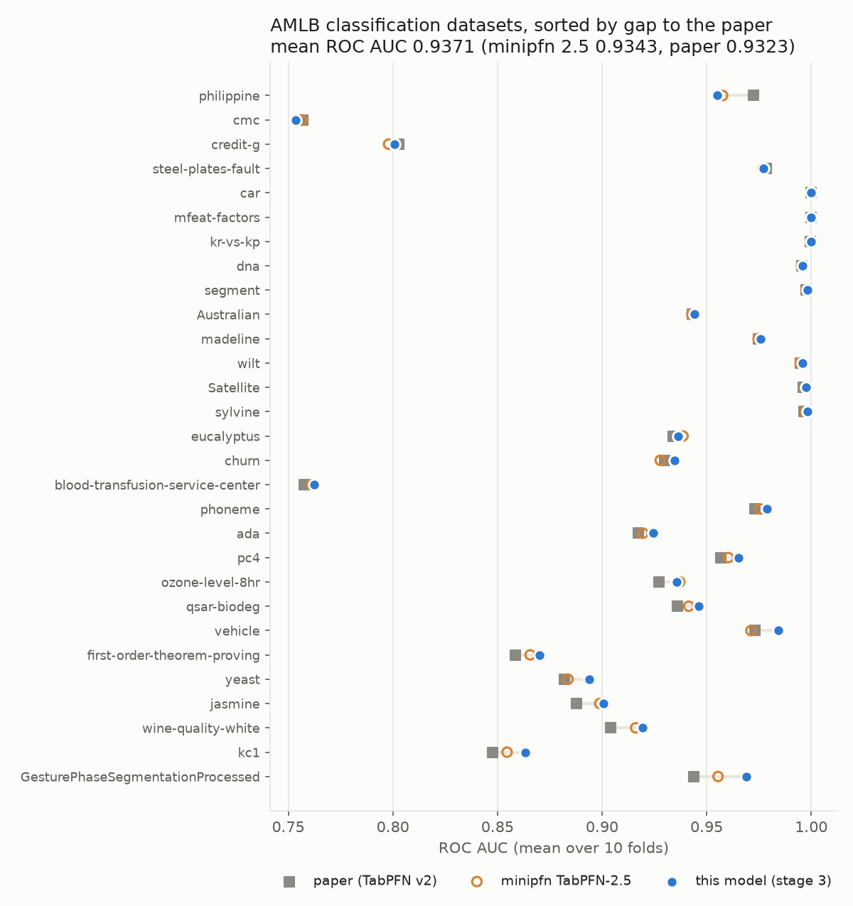
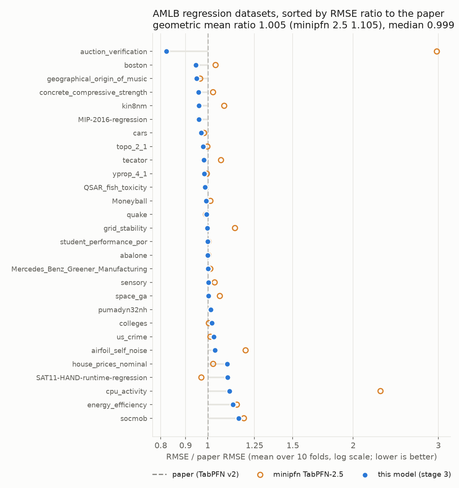
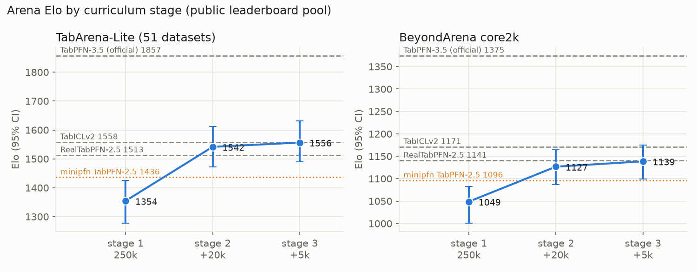

# minipfn TabPFN-3.5 (reproduction)

A from-scratch reimplementation of TabPFN-3.5 ([TabPFN-3.5: Technical Report](https://arxiv.org/abs/2609.17895), Prior Labs, 2026). One set of weights serves both classification and regression, as in the report. It is trained only on the open TabICL prior, with the three-stage curriculum of TabICLv2. Code: [Aiden-Jeon/minipfn](https://github.com/Aiden-Jeon/minipfn) (model `src/minipfn/models/column_row_transformer.py`, settings `src/minipfn/recipes/tabpfn_v3.py`).

This is not the official TabPFN-3.5 checkpoint, and it includes no official code or weights. The official weights are released by Prior Labs under their own license; see [PriorLabs/TabPFN](https://github.com/PriorLabs/TabPFN). The architecture follows the TabPFN-3 and TabPFN-3.5 reports. A few details the reports leave out were read from Prior Labs' public inference code (Apache-2.0) and reimplemented; no code was copied. The reports do not publish the training recipe, the prior or the 3.5 layer count, so those parts are our own choices (marked below).

## Model

- Architecture: column → row → in-context stages (TabPFN-3 layout with the TabPFN-3.5 changes), 218,826,424 parameters. Of these, 204,476,336 are shared by the two tasks, 5,027,456 are classification-only and 9,322,632 are regression-only:
  - **Cell encoder:** each feature is z-normalised over the training rows, and missing cells get an indicator. A feature's token holds 3 features (j, j+1, j+3, wrapping around). The TabPFN-3.5 encoder adds 32 learned Fourier frequencies and within-column ECDF ranks, then a LayerNorm. Width 128.
  - **Column stage:** 3 blocks per column, each with 128 inducing points that summarise the training rows (induced set attention). Test rows read the summary but never each other.
  - **Row stage:** 3 blocks with 8 learned CLS tokens per row (RoPE). The 8 CLS outputs are joined into one 1,024-wide row vector.
  - **In-context stage:** 24 layers, 16 heads, QK-norm and QASSMax (query-aware scalable softmax). Training rows attend to each other; test rows attend to training rows only, through a single key/value head. The 3.5 report does not give the layer count; 24 (from TabPFN-3) gives 219M parameters, close to the report's 220M.
  - **Outputs:** classification uses a many-class retrieval decoder (6 heads × 64). Regression uses a bar distribution over 5,000 buckets. The label encoders and a pre-head MLP are separate per task; everything else is shared.
  - RMSNorm (pre-norm), MLP 2× width, and an attention-logit soft-cap of 50 on every attention: logit ← 50·tanh(logit / 50). The soft-cap is our addition (see Training).
- Inputs: up to 160 classes (labels beyond the 10 label embeddings share embeddings, while the retrieval decoder still separates every class) and up to 1,000,000 training rows and 6,000 features (the report's recommended limits). Training covered up to 60,000 rows and 100 features.
- Prior: the TabICL graph SCM prior ([soda-inria/tabicl](https://github.com/soda-inria/tabicl)) with TabICLv2's table sizes (see Training).
- Inference: an ensemble of 8 members with standard scaling only, as the 3.5 report describes (quantile, robust and SVD members are gone). Each member shuffles features and classes and adds a random row-identifier column. Categorical columns with at most 20 categories are one-hot encoded in every member, as long as the table stays within 100 columns. Softmax temperature is 0.9. These settings ship in `config.json` (`inference`).

## Training

Three stages that follow TabICLv2's public training scripts ([arXiv 2602.11139](https://arxiv.org/abs/2602.11139), `scripts/train_v2_clf_stage{1,2,3}.sh`), with the changes listed below. Each stage starts from the previous stage's weights with a fresh optimizer: 1% warmup, then cosine decay. All stages use batches of 256 tables, Muon on every parameter (momentum 0.9, weight decay 0.01), bf16 and 32×H100. Each step trains one task, and the tasks alternate.

| Stage | Steps | Tables | Peak lr | Grad clip |
| --- | --- | --- | --- | --- |
| 1 | 250k | 1,024 rows, 30–90% of them training rows | 4e-4 | 10 |
| 2 | 20k | 400–10,240 rows (log-uniform), 79–81% training rows | 5e-5 | 10 |
| 3 | 5k | 400–60,000 rows (log-uniform), 79–81% training rows | 1e-5 | 1 |

In every stage, tables have 1–100 features (fewer for the longest tables). Half of the classification tables are binary, and 30% of the tables have missing values. Graphs and datasets that the TabICL filter marks as unpredictable are drawn again.

What differs from the TabICLv2 scripts (our choices):

- **One multitask model, batch 256.** TabICLv2 trains separate classification and regression models with batch 64. The step counts keep the number of tables per task the same: 500k × 64 = 250k × 256 / 2. Stages 2 and 3 follow the same rule.
- **Half the learning rates** (the scripts use 8e-4 / 1e-4 / 2e-5) **and an attention-logit soft-cap of 50.** The first stage-1 run used the script's lr without a soft-cap. From about 75k steps, the attention logits of the first in-context layers grew one layer at a time, to 10⁵–10⁶, until attention became one-hot. The run became unstable from about 105k steps (gradient norms rose) and collapsed after 140k. QK-norm is followed by QASSMax in this model (TabICLv2 has no QK-norm), so the attention temperature can grow through the QK-norm gains and QASSMax scales without limit. In 25k-step probes from a 50k checkpoint, the soft-cap kept the logits and QASSMax scales flat, and the soft-cap with half the lr gave the best validation loss on both tasks. Stage 1 was then restarted from scratch with both changes; it passed the earlier collapse point and kept improving.
- **Activation checkpointing in stage 3** for tables longer than 10,240 rows, to fit 60,000-row tables in GPU memory. It changes memory and speed only.

Compute: 32×H100 for about 34 hours (stage 1), 15 hours (stage 2) and 38 hours (stage 3), about 2,800 H100-hours. This does not count the discarded first stage-1 run or shorter experiments.

The weights in this repo (`sha256:01238841bddc`, the first 12 hex digits of the SHA-256 of `model.safetensors`) are the raw weights at the end of stage 3. They are not a weight average: LAWA (the mean of the last 10 snapshots, 100 steps apart) was tracked only as a validation metric. Every figure and number on this card was measured with these weights, or with the stage-1 and stage-2 branch weights where noted.

Train loss is the per-task mean over 2,000 steps (stage 1) or 500 steps (stages 2–3); every step samples new prior tables. Validation uses 64 fixed prior tables per task at that stage's sizes. Final values (CE / NLL): 0.216 / −2.554 after stage 1, 0.272 / −2.538 after stage 2 and 0.340 / −2.139 after stage 3. Later stages have longer tables, so these values are not comparable across stages.



## Results

### TabPFN v2 benchmark

The 29 AMLB classification and 28 regression datasets from the TabPFN v2 paper, 10 OpenML folds each. Classification is scored by mean ROC AUC. For regression, each dataset's RMSE is divided by the paper's, and the table gives the geometric mean of these ratios (below 1 is better than the paper). The reference values are the TabPFN v2 paper's (Supplementary Tables 1 and 2, default settings). "minipfn TabPFN-2.5" is our TabPFN-2.5 reimplementation ([classifier](https://huggingface.co/aiden-jeon/minipfn-tabpfn-v2-5-classifier), [regressor](https://huggingface.co/aiden-jeon/minipfn-tabpfn-v2-5-regressor)), scored with the same code.

| Checkpoint | Mean ROC AUC | RMSE ratio (geo. mean) |
| --- | --- | --- |
| Stage 1 (250k steps) | 0.9358 | 1.075 |
| Stage 2 (+20k steps) | 0.9370 | 1.005 |
| **Stage 3 (+5k steps, this model)** | **0.9371** | **1.005** |
| minipfn TabPFN-2.5 | 0.9343 | 1.105 |
| TabPFN v2 paper | 0.9323 | 1 |



Classification: this model matches or beats the paper on 25 of 29 datasets and minipfn TabPFN-2.5 on 25 of 29. The largest gap is philippine (5,832 rows × 308 features, −0.017), a table wider than anything seen in training. The next are cmc (−0.003) and credit-g (−0.002).

Regression: the median RMSE ratio is 0.999, and 25 of 28 datasets are within 1.1× of the paper. The worst are socmob (1.16), energy_efficiency (1.13) and cpu_activity (1.11). The RMSE is lower than minipfn TabPFN-2.5's on 22 of 28 datasets (geometric mean ratio 0.91).

Most of the regression gain came from stage 2, the first stage with long tables: the ratio fell from 1.075 to 1.005, and 20 of 28 datasets improved. Stage 3 changed little on this suite.





### TabArena-Lite

[TabArena-Lite](https://huggingface.co/spaces/TabArena/leaderboard) (51 datasets, one split each), scored the way the public leaderboard is: Elo against the leaderboard's method pool, with RandomForest (default) at 1000. The same weights serve the classification and regression splits. No split exceeds the size limit (1,000,000 training rows, 6,000 features, 160 classes), so none is imputed. Every method on the public leaderboard is 8-fold bagged; this model is fit once per split.

| Method | Elo | Imputed splits |
| --- | --- | --- |
| TabPFN-3.5 (default), public | 1857 | |
| TabPFN-3 (default), public | 1620 | |
| TabICLv2 (default), public | 1558 | |
| **minipfn TabPFN-3.5 (this model)** | **1556** (+75/−67) | 0.0% |
| RealTabPFN-2.5 (default), public | 1513 | |
| minipfn TabPFN-2.5 | 1436 | 7.8% |

By stage, the Elo was 1354 (+72/−77) after stage 1, 1542 (+70/−70) after stage 2 and 1556 after stage 3. This model places 16th of 99 methods. By problem type its Elo is 1568 (binary), 1635 (multiclass) and 1663 (regression), and it beats XGBoost (default) on 90% of the splits. The official TabPFN-3.5 is still about 300 Elo higher.



### BeyondArena

BeyondArena core2k (2,000 splits from 142 datasets), scored like its public leaderboard with XGBoost (default) at 1000. 1,999 splits run. The one above the size limit (amex_non_iid_1m, more than 1,000,000 training rows) takes RandomForest (default)'s result. On tables with more than 6,000 features, each ensemble member uses a random subset of 6,000 features (like the official `max_features_per_estimator`).

| Method | Elo |
| --- | --- |
| TabPFN-3.5 (default), public | 1375 |
| TabPFN-3 (default), public | 1232 |
| TabICLv2 (default), public | 1171 |
| RealTabPFN-2.5 (default), public | 1141 |
| **minipfn TabPFN-3.5 (this model)** | **1139** (+36/−39) |
| minipfn TabPFN-2.5 | 1096 |
| XGBoost (default), public | 1000 |

By stage, the Elo was 1049 → 1127 → 1139. This model places 20th of 41 methods. It is strongest on tiny tables (Elo 1317), low-dimensional tables (1276), random splits (1258) and small tables (1237). It is weakest on large tables (676), high-cardinality categorical features (738), temporal splits (740), text features (874) and high-dimensional tables (909).

## Limitations

- **Synthetic prior only.** The model never saw real data during training.
- **Recipe differs from the report.** The training recipe, layer count, soft-cap and learning rates are our choices; the reports do not give them.
- **Large and wide tables.** Training stopped at 60,000 rows and 100 features. Large tables, high-cardinality categoricals and temporal splits are the weakest BeyondArena groups, and the gap to the official TabPFN-3.5 is largest there.
- **Stage 3 gain is small.** Every stage-3 improvement over stage 2 is inside the confidence intervals.
- **Inference cost of the soft-cap.** On GPU the soft-capped attention runs as a FlexAttention kernel, which was 1.3–2.2× slower than plain SDPA on 10,000–30,000-row tables (the first call also compiles it, about 20 s per process). On CPU the full logit matrix is built, so large tables are slow.

## Usage

```bash
uv pip install "minipfn @ git+https://github.com/Aiden-Jeon/minipfn"
```

```python
from minipfn import TabPFNv3_5Classifier, TabPFNv3_5Regressor

# both download aiden-jeon/minipfn-tabpfn-v3-5 (one multitask model)
# x_train can be a pandas DataFrame with categorical columns
clf = TabPFNv3_5Classifier(device="cuda").fit(x_train, y_train)
proba = clf.predict_proba(x_test)  # (n_test, n_classes), columns in clf.classes_ order

reg = TabPFNv3_5Regressor(device="cuda").fit(x_train, y_train)
pred = reg.predict(x_test)  # mean of the predictive distribution
```

Each class above loads its own copy of the 219M weights. To use both tasks with one copy, load the model once and pass it in (the inference settings come with it):

```python
from minipfn import from_pretrained

model, borders = from_pretrained("aiden-jeon/minipfn-tabpfn-v3-5")
clf = TabPFNv3_5Classifier(model, device="cuda")
reg = TabPFNv3_5Regressor(model, borders, device="cuda")
```

`fit` does not train weights. It fits each ensemble member's preprocessing on the training rows, which then serve as context at prediction time. To reproduce the benchmark (downloads the OpenML tasks):

```bash
uv run python scripts/tabpfn_v2/eval.py --suite all \
  --classifier-path hf://aiden-jeon/minipfn-tabpfn-v3-5 \
  --regressor-path hf://aiden-jeon/minipfn-tabpfn-v3-5
```

For BeyondArena, add `--max-features-per-member 6000`.

## Intermediate checkpoints

The weights at the end of stages 1 and 2 are kept as branches of this repo. Each branch holds the weights, config and a short README that points back here; this card on `main` describes all of them.

| Branch | Weights | Mean ROC AUC | RMSE ratio | TabArena-Lite Elo | BeyondArena Elo |
| --- | --- | --- | --- | --- | --- |
| `stage1-250k` | `sha256:2ddf63bce395` | 0.9358 | 1.075 | 1354 | 1049 |
| `stage2-20k` | `sha256:4e7bc2d7a6ed` | 0.9370 | 1.005 | 1542 | 1127 |
| `main` (stage 3, +5k) | `sha256:01238841bddc` | 0.9371 | 1.005 | 1556 | 1139 |

```python
clf = TabPFNv3_5Classifier("aiden-jeon/minipfn-tabpfn-v3-5@stage2-20k")
```

In the benchmark script, write the branch after `@`: `--classifier-path hf://aiden-jeon/minipfn-tabpfn-v3-5@stage2-20k`.

## Files

- `model.safetensors`: weights, plus the regression bucket borders (`borders`)
- `config.json`: model size and soft-cap (`ColumnRowTransformerConfig` fields), task (`multitask`) and inference settings
- `images/`: figures used in this card

## License

Apache-2.0. The training data were generated with the TabICL prior (BSD-3-Clause); no TabICL code is included here. No TabPFN-3 or TabPFN-3.5 code or weights are included.

## Citation

```bibtex
@article{priorlabs2026tabpfn35,
  title   = {{TabPFN-3.5}: Technical Report},
  author  = {{Prior Labs}},
  journal = {arXiv preprint arXiv:2609.17895},
  year    = {2026}
}

@article{priorlabs2026tabpfn3,
  title   = {{TabPFN-3}: Technical Report},
  author  = {{Prior Labs}},
  journal = {arXiv preprint arXiv:2605.13986},
  year    = {2026}
}

@inproceedings{qu2025tabicl,
  title     = {{TabICL}: A Tabular Foundation Model for In-Context Learning on Large Data},
  author    = {Qu, Jingang and Holzm{\"u}ller, David and Varoquaux, Ga{\"e}l and Le Morvan, Marine},
  booktitle = {International Conference on Machine Learning},
  year      = {2025}
}
```
